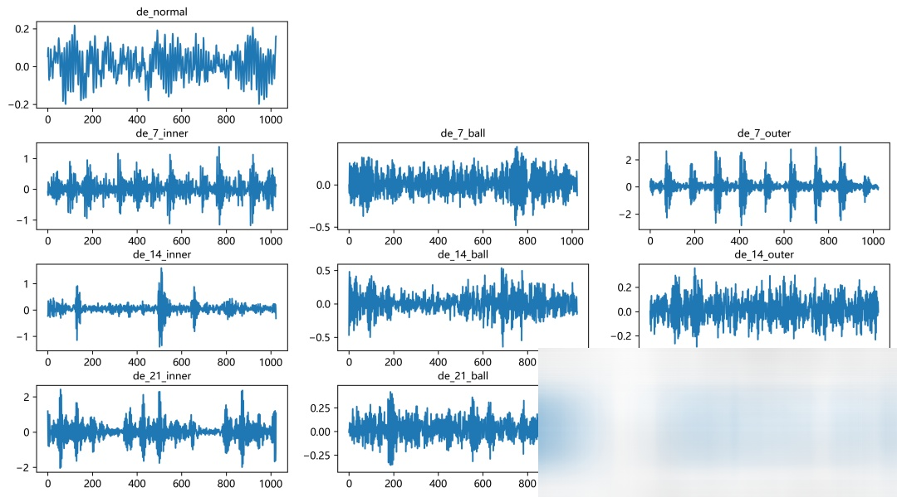
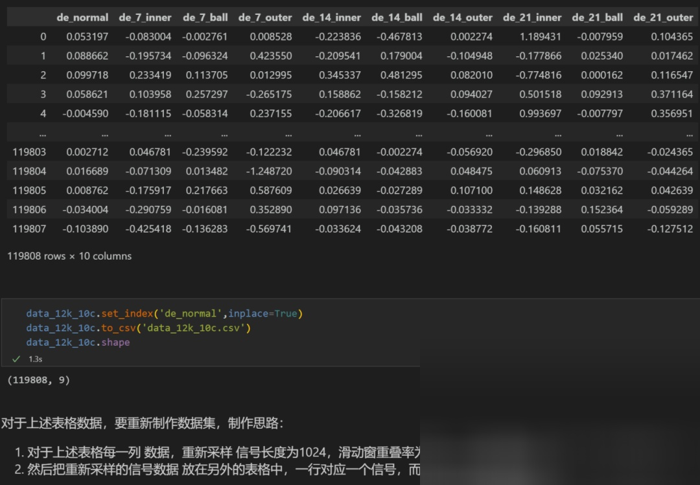

# Fault Diagnosis! Multimodal Fusion Classification Model Based on GADF+SwinTransformer -CBAM+GRU

Preface
This issue introduces a parallel multimodal fusion classification model based on 1D-GRU+2D-GADF-SwinTransformer-CBAM, which has achieved significant results in fault diagnosis tasks!
1. Model Introduction and Innovation Points
1.1 SwinTransformer Introduction
SwinTransformer is a backbone model for general vision tasks, replacing CNNs:
 (1)Hierarchical Design:
SwinTransformer introduces the concept of hierarchical feature representation, similar to the pyramid structure commonly found in CNNs. This allows it to be more efficient when processing high-resolution images, gradually aggregate information, and address different visual tasks with multiscale features.
 (2)Sliding Window Mechanism:
SwinTransformer calculates attention through sliding windows, significantly reducing the computational complexity within each window. This local attention mechanism effectively addresses the computational bottleneck issues of ViT when handling high-resolution image processing.
 (3)Shifted Window Strategy:
To enhance information exchange between different windows, SwinTransformer adopts a shifted window strategy (Shifted Window). This strategy achieves cross-window information interaction by moving the window position across layers, thereby enhancing the model's expressive power.
1.2 Model Introduction
The model combines time-frequency images and one-dimensional time series signals, and uses a CBMAs attention mechanism to optimize the SwinTransformer and GRU multimodal feature fusion model for fault signal classification. It can effectively combine the spatial features of time-frequency images and the temporal sequence features of one-dimensional signals, fully leveraging the advantages of multimodal features.
● Dataset: CWRU West University Bearing Dataset
Environmental Framework: Python 3.11, PyTorch 2.1 and above are compatible for execution.
Time-Frequency Image Transformation: Offers five methods for time-frequency image transformation.
Accuracy: Test set achieves 98% accuracy.
Target Audience: Those requiring papers or graduation projects.
Code Guarantees: Code is detailed with comments, ready to run without further adjustments.
Note: We also provide accompanying model explanations (facilitating understanding of network architecture) and parameter tuning guides! For those with graduation project requirements or needing to write a thesis paper, this is essential. The module is rich in content, highly innovative, and boasts superior performance!
Innovation Points:
Innovation One: Multimodal Fusion
This model integrates both time-frequency images and one-dimensional time-series signals through multimodal fusion, fully leveraging the complementary nature of these two types of data. Time-frequency images are visualized using Gram-Charlier Fields (GAF), capturing the frequency and temporal characteristics of the signal. Meanwhile, one-dimensional time-series signals retain the original temporal dependence, suitable for processing with Recurrent Neural Networks (RNN) or GRU. By fusing these features:
Time-frequency images capture the high-frequency and low-frequency trends in the signal, aiding in identifying fault characteristics in the frequency domain.
One-dimensional time-series signals preserve the temporal dependence of the signal, reflecting the dynamic evolution of faults over time.
This dual-channel data fusion enables the model to simultaneously utilize time, frequency, and image features, significantly enhancing the accuracy of fault classification.
Innovation Two: SwinTransformer Optimized with CBAM Attention Mechanism
CBAM (Convolutional Block Attention Module) is an attention mechanism for Convolutional Neural Networks (CNNs), aimed at improving model representation capabilities. CBAM enhances feature representation by combining channel attention (Channel Attention) and spatial attention (Spatial Attention), thereby boosting model performance.
2.1 Data Import

Inserting the CBAM module into SwinTransformer to enhance feature representation: The CBAM module provides two modules, channel attention and spatial attention, which respectively enhance feature representation from the channel dimension and spatial dimension of the feature map. By inserting CBAM after SwinTransformer, the network can better capture the importance of different features, thereby effectively extracting and aggregating information at deeper levels.

Innovation Three: Time-series feature extraction based on one-dimensional signal sequence stacking
When processing one-dimensional time-series signals, we stacked one-dimensional signal sequence data and used GRU (Gated Recurrent Unit) to extract time-series features. This innovative design accelerates the computational efficiency of GRU, allowing for more effective extraction of critical features during fault occurrence, significantly improving the accuracy of signal classification.

Innovation Four: Feature fusion advantage
In the model, the multimodal fusion part extracts both time-frequency image features and one-dimensional signal features processed by GRU. We adopted a feature concatenated fusion method to combine these two types of features. Compared to traditional models that only use single mode features, the fused features perform better in classification tasks. The main advantages are:
Time-frequency image and time-series signals provide different perspectives of feature information. The former provides frequency domain features, while the latter retains temporal dependency characteristics. The combination of the two can more comprehensively reflect the fault characteristics of the signal.
Through feature fusion, the model is more robust in capturing fault features under different modes, especially in complex fault signal environments. The fused features can better handle noise interference and signal changes.
This feature fusion strategy allows our model to maintain high-efficiency and accurate classification performance in various fault modes, enhancing its robustness and generalization ability in practical applications.
1. Preprocessing for Classification 10
2. KSU Bearing Data: 10-Classification Dataset
   - Train set, Val set, Test set are divided as 7:2:1 according to the training, validation, and testing sets respectively, with data saved at the end.
   - The figure above shows the data reading format and preprocessing idea.

2.2 Data Preprocessing, Video Image Transformation
   - We provide five time-frequency image transformation methods including Markov Transition Field (MTF), Recursive Graph (RP), Gram Angle Field (GAF), Continuous Wavelet Transform (CWT), Short-Time Fourier Transform (STFT), which can flexibly replace the time-frequency image types in multimodal features!
   - In this paper, we use the Gram Angle Field (GAF) as the method of time-frequency image transformation, and the generated time-frequency images are as follows:

3. Multimodal Fusion Bearing Fault Diagnosis Model
   - Setting parameters and training the model
   - 50 epochs, accuracy rate of 98%, significantly improved by using a 1D-GRU + 2D-GADF-SwinTransformer-CBAM network for classification, the model can fully extract the spatial and temporal features of bearing fault signals, converges quickly, has excellent performance, high accuracy, and noticeable effects!
   - Model evaluation
   - Accuracy, Precision, Recall, F1 Score
   - Fault classification confusion matrix:
   - Other visualization graphs:
     - Classification label visualization
     - Original data t-SNE feature visualization
     - T-SNE feature visualization after model training:
       Download: Full original data, Python code

Previously interesting content:
Python Bearing Fault Diagnosis | From Beginner to Publication
Python Bearing Fault Diagnosis (14) High Innovation Fault Identification Model
SCI 1st Class High Innovation Bearing Fault Diagnosis Model!
High-Innovation Bearing Fault Diagnosis Model Based on GADF+Swin-CNN-GAM
Attention Magic Mod | Superb Bearing Fault Diagnosis Model!
Python Bearing Fault Diagnosis (19) - Innovation in Diagnosis Model Based on Transformer-BiLSTM
Bearing Fault Diagnosis Model Based on K-NN + GCN
27 Bearing Fault Diagnosis Models | The Most Affordable Full Set Online
Bearing Fault Diagnosis Model Based on KAN and Convolution of KAN
Time-frequency chart update | Bearing fault diagnosis based on visual top conference + time-frequency chart
Fault Diagnosis | Code Explanation + Live Classes, currently in progress!
Fault Diagnosis | Innovative Model Update: SSA-CNN-Transformer Diagnosis Model
Rapid Document | Parallel Fault Diagnosis Model Based on 2D-SWinTransformer + 1D-CNN-SENet
KAN, KAN convolution combined with attention mechanism!
Parallel Fault Diagnosis Model Based on 2D-SwinTransformer + BiGRU-GlobalAttention
Positional Decoding | Detailed Explanation of Positional Encoding in Transformer
Resource Sharing | Intelligent Fault Diagnosis and Prediction Based on Graph Neural Networks
Innovation Point | Fault Diagnosis Model Based on Fast Fourier Transform Convolution (FFC)
Code is open-source! | Domain Adversarial Networks for Fault Diagnosis under Variable Working Conditions
Over 30 open-source datasets | No more worries about data sets for fault diagnosis!
Fault Diagnosis | Essential for Master's and Doctoral Students to publish papers in their first and second years!
Superior! Top conference innovation integration! Parallel classification network based on 2D-SWinTransformer.
END  
2. Friends who enjoy this can click to follow, give the article a "like", share on social media or discuss in groups.

## Images

<!-- PAYMENT_BLOCK -->

## Get this dataset

- Payment link (Stripe): [Buy now](https://buy.stripe.com/3cs8yP7sY87d0vu9AB)
- Payment QR code: 

<!-- /PAYMENT_BLOCK -->
